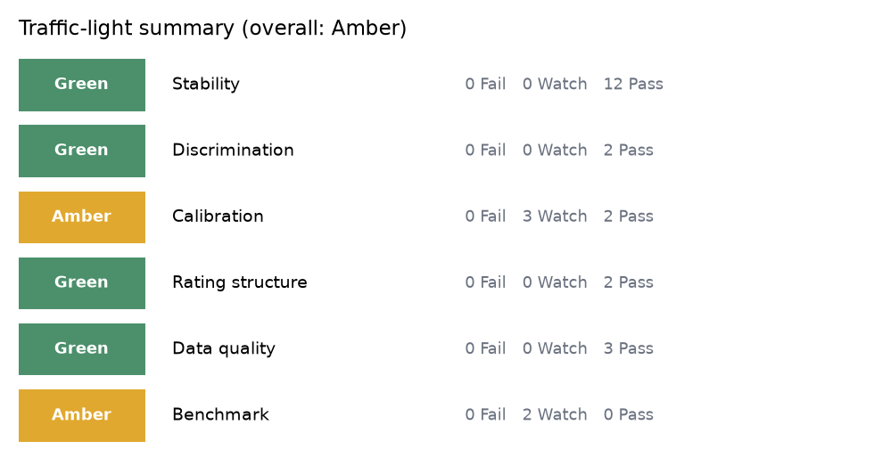
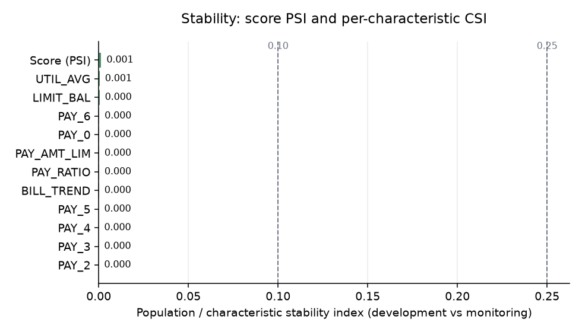
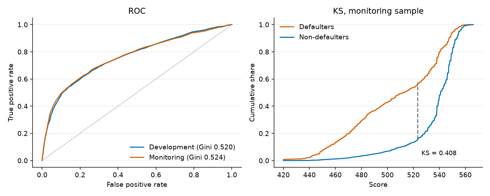
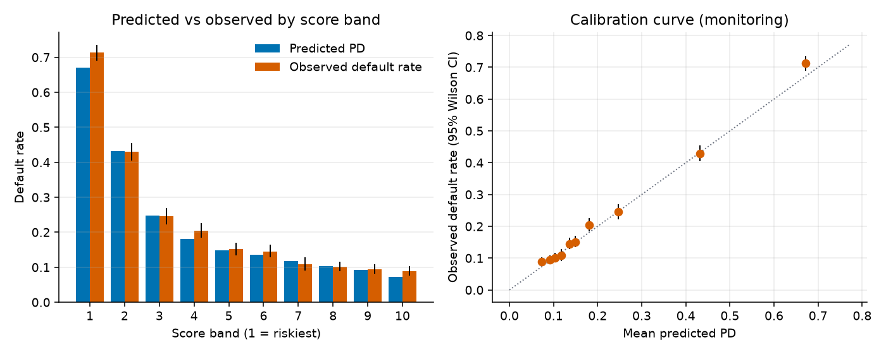

# Credit model audit report

_Generated by `model-audit`. Subject: a reference WoE scorecard built in this repository on a public dataset, audited against a simulated monitoring sample. This is a demonstration, not an assessment of any production model._

## 1. Scope and set-up

- Development sample: 15,000 accounts, observed default rate 21.66%, mean predicted PD 21.66%.
- Monitoring sample: 15,000 rows (after injected duplicates), observed default rate 22.58%, mean predicted PD 21.75%.
- Score scale: 600 points at 50:1 good:bad odds, PDO 20; random seed 42.
- Scorecard: optbinning binning, characteristics LIMIT_BAL, PAY_0, PAY_2, PAY_3, PAY_4, PAY_5, PAY_6, PAY_RATIO, UTIL_AVG, PAY_AMT_LIM, BILL_TREND; dropped for a wrong-sign coefficient: PAY6_RATIO, AGE; regularisation tuned by 5-fold CV: C = 0.1, L1 share 0.
- Status rule: Pass / Watch / Fail against the thresholds shown per check; the thresholds are conventions and must be aligned with the institution's policy.

## 2. Summary

**0 Fail, 5 Watch, 21 Pass** out of 26 checks.

Overall rating: Amber (worst area; see rule in section 5).

| Area | Rating | Fail | Watch | Pass |
|---|---|---|---|---|
| Stability | Green | 0 | 0 | 12 |
| Discrimination | Green | 0 | 0 | 2 |
| Calibration | Amber | 0 | 3 | 2 |
| Rating structure | Green | 0 | 0 | 2 |
| Data quality | Green | 0 | 0 | 3 |
| Benchmark | Amber | 0 | 2 | 0 |

| ID | Check | Metric | Value | Threshold | Status |
|---|---|---|---|---|---|
| DQ-01 | Missing values | max missing share (monitoring) | 0 | Watch >= 1%, Fail >= 5% per column | Pass |
| DQ-02 | Out-of-range values | max out-of-range share (monitoring) | 0 | Watch > 0.0%, Fail > 0.1% per column | Pass |
| DQ-03 | Duplicate IDs | duplicate share of IDs (monitoring) | 0 | Watch > 0.0%, Fail > 0.1% | Pass |
| ST-01 | Score PSI | PSI of final score (10 development deciles) | 0.00135 | Watch >= 0.1, Fail >= 0.25 | Pass |
| ST-02:LIMIT_BAL | CSI LIMIT_BAL | CSI of LIMIT_BAL on scorecard bins | 0.0004519 | Watch >= 0.1, Fail >= 0.25 | Pass |
| ST-02:PAY_0 | CSI PAY_0 | CSI of PAY_0 on scorecard bins | 0.0002759 | Watch >= 0.1, Fail >= 0.25 | Pass |
| ST-02:PAY_2 | CSI PAY_2 | CSI of PAY_2 on scorecard bins | 2.779e-05 | Watch >= 0.1, Fail >= 0.25 | Pass |
| ST-02:PAY_3 | CSI PAY_3 | CSI of PAY_3 on scorecard bins | 4.478e-05 | Watch >= 0.1, Fail >= 0.25 | Pass |
| ST-02:PAY_4 | CSI PAY_4 | CSI of PAY_4 on scorecard bins | 5.21e-05 | Watch >= 0.1, Fail >= 0.25 | Pass |
| ST-02:PAY_5 | CSI PAY_5 | CSI of PAY_5 on scorecard bins | 7.907e-05 | Watch >= 0.1, Fail >= 0.25 | Pass |
| ST-02:PAY_6 | CSI PAY_6 | CSI of PAY_6 on scorecard bins | 0.000288 | Watch >= 0.1, Fail >= 0.25 | Pass |
| ST-02:PAY_RATIO | CSI PAY_RATIO | CSI of PAY_RATIO on scorecard bins | 0.0002106 | Watch >= 0.1, Fail >= 0.25 | Pass |
| ST-02:UTIL_AVG | CSI UTIL_AVG | CSI of UTIL_AVG on scorecard bins | 0.0005031 | Watch >= 0.1, Fail >= 0.25 | Pass |
| ST-02:PAY_AMT_LIM | CSI PAY_AMT_LIM | CSI of PAY_AMT_LIM on scorecard bins | 0.0002114 | Watch >= 0.1, Fail >= 0.25 | Pass |
| ST-02:BILL_TREND | CSI BILL_TREND | CSI of BILL_TREND on scorecard bins | 0.0001603 | Watch >= 0.1, Fail >= 0.25 | Pass |
| DI-01 | Gini drift | Gini drop, development minus monitoring | -0.00352 | Watch >= 0.05, Fail >= 0.1 (absolute points) | Pass |
| DI-02 | KS drift | KS drop, development minus monitoring | -0.006258 | Watch >= 0.03, Fail >= 0.07 (absolute points) | Pass |
| CA-01 | Hosmer-Lemeshow | HL p-value, monitoring (10 groups) | 0.04334 | Watch <= 0.05, Fail <= 0.01 | Watch |
| CA-02 | Binomial test per grade | grades failing the one-sided test (p <= 0.01) | 1 | Pass: no grade p < 0.05; Fail: >= 2 grades p <= 0.01; otherwise Watch | Watch |
| CA-05 | Jeffreys test per grade | grades failing the Jeffreys test (p <= 0.01) | 1 | Pass: no grade p < 0.05; Fail: >= 2 grades p <= 0.01; otherwise Watch | Watch |
| CA-03 | Brier score | relative Brier increase vs development | 0.01362 | Watch >= 5%, Fail >= 15% | Pass |
| CA-04 | Calibration in the large | |observed / predicted default rate - 1| | 0.0382 | Watch >= 10%, Fail >= 25% | Pass |
| RG-01 | Rating-grade concentration | HHI of monitoring grade distribution | 0.1286 | Watch >= 0.15, Fail >= 0.25 (minimum possible 0.125) | Pass |
| RG-02 | Monotonicity of default rates | grade-pair inversions, monitoring | 0 | Watch >= 1, Fail >= 2 inversions | Pass |
| BM-01 | Challenger gap, monitoring | Gini(challenger) - Gini(champion) on monitoring data | 0.05291 | Watch >= 0.03, Fail >= 0.06 (Gini points, challenger minus champion) | Watch |
| BM-02 | Challenger gap, development CV | mean fold Gini gap, 5-fold CV on development data | 0.04914 | Watch >= 0.03, Fail >= 0.06 (Gini points, challenger minus champion) | Watch |

## 3. Findings

Raised for every check that is not Pass. Risk rating: Fail = High, Watch = Medium.

| # | Ref | Observation | Risk | Recommendation |
|---|---|---|---|---|
| 1 | CA-01 Hosmer-Lemeshow | HL chi-square 18.8 on 10 df, p = 0.0433 (development in-sample p = 0.621). | Medium | Read together with the band table: if the deviation is directional and material, recalibrate the score-to-PD mapping; document the choice. |
| 2 | CA-02 Binomial test per grade | Observed default rate above grade PD in grade(s): 1 (8.2% vs 6.9%, n=1233, p=0.0498); 6 (21.6% vs 19.6%, n=2207, p=0.0126); 8 (71.3% vs 67.6%, n=1522, p=0.000952). | Medium | Recalibrate grade PDs or add a margin of conservatism; escalate where the under-prediction affects provisioning or pricing. |
| 3 | CA-05 Jeffreys test per grade | Grade PD likely too low in: 1 (p=0.0446, n=1233); 6 (p=0.0118, n=2207); 8 (p=0.000866, n=1522). | Medium | Use with CA-02. Where the two tests disagree, the grade is small enough that the conclusion should rest on the effect size, not the p-value. |
| 4 | BM-01 Challenger gap, monitoring | Gini 0.577 (challenger) vs 0.524 (champion), gap 0.053 (paired bootstrap 95% CI 0.041 to 0.064). Rank correlation of the two scores 0.81. | Medium | Review variables the challenger uses and the scorecard omits (feature importance, interactions) and decide whether to redevelop, add characteristics or accept the gap. |
| 5 | BM-02 Challenger gap, development CV | Gini 0.565 +/- 0.008 (challenger) vs 0.516 +/- 0.008 (champion), mean gap 0.049 +/- 0.006 over 5 folds (mean +/- sd; challenger won 5 of 5). | Medium | As BM-01. A gap that is stable across folds is structural; one driven by one fold is noise. |

### Tests without exception

- DQ-01 Missing values: No column exceeds the missing-value tolerance.
- DQ-02 Out-of-range values: No values outside the configured ranges.
- DQ-03 Duplicate IDs: No duplicate IDs.
- ST-01 Score PSI: Score PSI is 0.001; mean score moved from 529.6 to 529.5.
- ST-02:LIMIT_BAL CSI LIMIT_BAL: CSI 0.000; average score effect +0.0 points; largest move in bin (95000, 145000] (13.1% to 12.5%).
- ST-02:PAY_0 CSI PAY_0: CSI 0.000; average score effect -0.1 points; largest move in bin (-inf, -1.5] (9.4% to 9.0%).
- ST-02:PAY_2 CSI PAY_2: CSI 0.000; average score effect -0.0 points; largest move in bin (-inf, 1.5] (85.4% to 85.2%).
- ST-02:PAY_3 CSI PAY_3: CSI 0.000; average score effect +0.0 points; largest move in bin (-0.5, 0.5] (52.4% to 52.7%).
- ST-02:PAY_4 CSI PAY_4: CSI 0.000; average score effect -0.0 points; largest move in bin (-0.5, 0.5] (54.7% to 55.0%).
- ST-02:PAY_5 CSI PAY_5: CSI 0.000; average score effect +0.0 points; largest move in bin (-0.5, 1] (56.3% to 56.7%).
- ST-02:PAY_6 CSI PAY_6: CSI 0.000; average score effect +0.0 points; largest move in bin (-0.5, 1] (53.9% to 54.7%).
- ST-02:PAY_RATIO CSI PAY_RATIO: CSI 0.000; average score effect +0.0 points; largest move in bin (-inf, 0.000189374] (12.1% to 11.6%).
- ST-02:UTIL_AVG CSI UTIL_AVG: CSI 0.001; average score effect -0.0 points; largest move in bin (-inf, 0.307364] (51.7% to 50.9%).
- ST-02:PAY_AMT_LIM CSI PAY_AMT_LIM: CSI 0.000; average score effect +0.0 points; largest move in bin (0.00348886, 0.067575] (74.0% to 74.6%).
- ST-02:BILL_TREND CSI BILL_TREND: CSI 0.000; average score effect -0.0 points; largest move in bin (-inf, -0.0422182] (21.3% to 21.7%).
- DI-01 Gini drift: Gini 0.520 (95% CI 0.500-0.540) in development vs 0.524 (95% CI 0.502-0.543) in monitoring, a drop of -0.004 (95% CI -0.031 to 0.025).
- DI-02 KS drift: KS 0.402 (95% CI 0.387-0.422) in development vs 0.408 (95% CI 0.395-0.429) in monitoring, a drop of -0.006 (95% CI -0.030 to 0.015).
- CA-03 Brier score: Brier 0.1359 (development) vs 0.1378 (monitoring), +1.4%; the base-rate benchmark is 0.1748.
- CA-04 Calibration in the large: Predicted default rate 21.75% vs observed 22.58% (ratio 1.04; development ratio 1.00).
- RG-01 Rating-grade concentration: HHI 0.129 vs 0.129 in development (floor 0.125 for 8 grades); largest grade is 6 with 14.7% of accounts.
- RG-02 Monotonicity of default rates: Default rates are monotone across all 8 grades (development inversions: 0).

## 4. Supporting evidence

### Stability

| feature | csi | points_shift | status |
|---|---|---|---|
| LIMIT_BAL | 0.000 | 0.029 | Pass |
| PAY_0 | 0.000 | -0.139 | Pass |
| PAY_2 | 0.000 | -0.009 | Pass |
| PAY_3 | 0.000 | 0.009 | Pass |
| PAY_4 | 0.000 | -0.000 | Pass |
| PAY_5 | 0.000 | 0.005 | Pass |
| PAY_6 | 0.000 | 0.016 | Pass |
| PAY_RATIO | 0.000 | 0.020 | Pass |
| UTIL_AVG | 0.001 | -0.004 | Pass |
| PAY_AMT_LIM | 0.000 | 0.006 | Pass |
| BILL_TREND | 0.000 | -0.019 | Pass |

### Discrimination

| metric | sample | value | 95% CI |
|---|---|---|---|
| AUC | dev | 0.760 | 0.750 to 0.770 |
| AUC | mon | 0.762 | 0.752 to 0.773 |
| Gini | dev | 0.520 | 0.500 to 0.540 |
| Gini | mon | 0.524 | 0.502 to 0.543 |
| KS | dev | 0.402 | 0.387 to 0.422 |
| KS | mon | 0.408 | 0.395 to 0.429 |

### Calibration by score band (monitoring)

| band | n | mean_pd | observed_dr | ci_low | ci_high |
|---|---|---|---|---|---|
| 1 | 1522 | 67.1% | 71.3% | 69.0% | 73.5% |
| 2 | 1483 | 43.2% | 43.0% | 40.5% | 45.5% |
| 3 | 1347 | 24.8% | 24.5% | 22.3% | 26.9% |
| 4 | 1422 | 18.1% | 20.4% | 18.4% | 22.6% |
| 5 | 1461 | 14.9% | 15.1% | 13.4% | 17.1% |
| 6 | 1482 | 13.6% | 14.5% | 12.8% | 16.4% |
| 7 | 1080 | 11.8% | 10.8% | 9.1% | 12.8% |
| 8 | 1799 | 10.3% | 10.1% | 8.8% | 11.6% |
| 9 | 1625 | 9.1% | 9.4% | 8.1% | 10.9% |
| 10 | 1779 | 7.3% | 8.8% | 7.6% | 10.2% |

### Binomial test by rating grade (monitoring)

| grade | n | defaults | grade_pd | observed_dr | p_value | status | p_holm |
|---|---|---|---|---|---|---|---|
| 1 | 1233 | 101 | 6.9% | 8.2% | 0.05 | Watch | 0.3 |
| 2 | 2171 | 209 | 8.9% | 9.6% | 0.13 | Pass | 0.64 |
| 3 | 1799 | 182 | 10.3% | 10.1% | 0.63 | Pass | 1 |
| 4 | 2024 | 247 | 12.5% | 12.2% | 0.66 | Pass | 1 |
| 5 | 1999 | 306 | 14.6% | 15.3% | 0.21 | Pass | 0.82 |
| 6 | 2207 | 476 | 19.6% | 21.6% | 0.013 | Watch | 0.088 |
| 7 | 2045 | 781 | 39.0% | 38.2% | 0.77 | Pass | 1 |
| 8 | 1522 | 1085 | 67.6% | 71.3% | 0.00095 | Fail | 0.0076 |

### Jeffreys test by rating grade (monitoring)

| grade | n | defaults | grade_pd | p_value | status | p_holm |
|---|---|---|---|---|---|---|
| 1 | 1233 | 101 | 6.9% | 0.045 | Watch | 0.27 |
| 2 | 2171 | 209 | 8.9% | 0.12 | Pass | 0.6 |
| 3 | 1799 | 182 | 10.3% | 0.61 | Pass | 1 |
| 4 | 2024 | 247 | 12.5% | 0.64 | Pass | 1 |
| 5 | 1999 | 306 | 14.6% | 0.2 | Pass | 0.79 |
| 6 | 2207 | 476 | 19.6% | 0.012 | Watch | 0.083 |
| 7 | 2045 | 781 | 39.0% | 0.76 | Pass | 1 |
| 8 | 1522 | 1085 | 67.6% | 0.00087 | Fail | 0.0069 |

### Rating grades

| grade | dev_share | mon_share | dev_dr | mon_dr |
|---|---|---|---|---|
| 1 | 8.4% | 8.2% | 6.4% | 8.2% |
| 2 | 13.8% | 14.5% | 8.8% | 9.6% |
| 3 | 11.9% | 12.0% | 10.8% | 10.1% |
| 4 | 14.3% | 13.5% | 12.1% | 12.2% |
| 5 | 13.4% | 13.3% | 14.8% | 15.3% |
| 6 | 14.3% | 14.7% | 20.9% | 21.6% |
| 7 | 14.4% | 13.6% | 38.6% | 38.2% |
| 8 | 9.6% | 10.1% | 66.7% | 71.3% |

### Champion vs challenger

| model | cv_gini | mon_gini | mon_ks | mon_brier | mean_pd |
|---|---|---|---|---|---|
| Champion scorecard | 0.516 +/- 0.008 | 0.524 | 0.408 | 0.138 | 21.7% |
| Challenger LightGBM | 0.565 +/- 0.008 | 0.577 | 0.439 | 0.134 | 21.8% |

| fold | champion_gini | challenger_gini | champion_auc | challenger_auc | champion_ks | challenger_ks |
|---|---|---|---|---|---|---|
| 1 | 0.510 | 0.562 | 0.755 | 0.781 | 0.409 | 0.419 |
| 2 | 0.526 | 0.569 | 0.763 | 0.785 | 0.405 | 0.432 |
| 3 | 0.522 | 0.576 | 0.761 | 0.788 | 0.410 | 0.442 |
| 4 | 0.507 | 0.562 | 0.753 | 0.781 | 0.392 | 0.424 |
| 5 | 0.515 | 0.557 | 0.758 | 0.779 | 0.419 | 0.440 |

Challenger hyper-parameters (Optuna, TPE, 5-fold CV log loss):

| parameter | value |
|---|---|
| n_estimators | 412.0000 |
| learning_rate | 0.0150 |
| num_leaves | 19.0000 |
| min_child_samples | 40.0000 |
| subsample | 0.9396 |
| colsample_bytree | 0.5582 |
| reg_lambda | 24.7704 |
| features | 26.0000 |

### Data quality

| column | dev_missing | mon_missing |
|---|---|---|
| LIMIT_BAL | 0.0% | 0.0% |
| AGE | 0.0% | 0.0% |
| PAY_0 | 0.0% | 0.0% |
| PAY_2 | 0.0% | 0.0% |
| PAY_3 | 0.0% | 0.0% |
| PAY_4 | 0.0% | 0.0% |
| PAY_5 | 0.0% | 0.0% |
| PAY_6 | 0.0% | 0.0% |
| PAY_RATIO | 0.0% | 0.0% |
| UTIL_AVG | 0.0% | 0.0% |
| PAY6_RATIO | 0.0% | 0.0% |
| PAY_AMT_LIM | 0.0% | 0.0% |
| BILL_TREND | 0.0% | 0.0% |
| BILL_AMT1 | 0.0% | 0.0% |
| PAY_AMT1 | 0.0% | 0.0% |

| column | allowed | violations | share |
|---|---|---|---|
| LIMIT_BAL | [10000, 1000000] | 0 | 0.0% |
| AGE | [18, 100] | 0 | 0.0% |
| PAY_0 | [-2, 9] | 0 | 0.0% |
| PAY_2 | [-2, 9] | 0 | 0.0% |
| PAY_3 | [-2, 9] | 0 | 0.0% |
| PAY_AMT1 | [0, 2000000] | 0 | 0.0% |

## 5. Method notes

- Every metric is re-computed from record-level data with the library code in `src/model_audit`; nothing is taken from model documentation.
- PD: cubic logistic recalibration of default on the standardised score, fitted on the development sample, frozen and applied to monitoring (calibrate_pd = false falls back to the points-scale PD, logit(PD) = (offset - score) / factor).
- Bootstrap CIs: percentile method, resampling accounts with replacement.
- Hosmer-Lemeshow on monitoring uses groups degrees of freedom (frozen model).
- Traffic light: an area is Red if any of its checks Fails, Amber if any is Watch, otherwise Green. The overall rating is the worst area.
- Large samples make formal tests reject small deviations: read p-values with the effect sizes.
