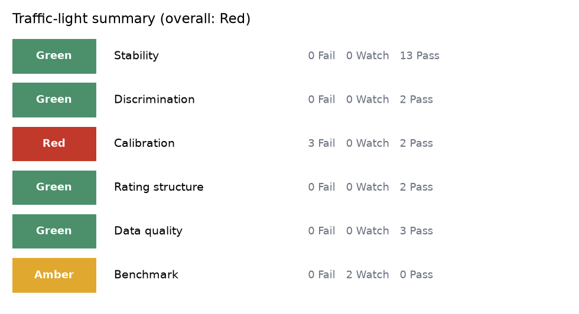
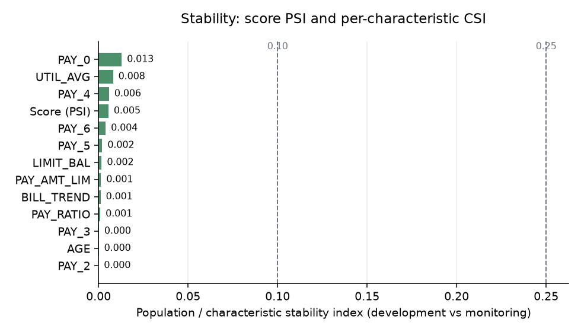
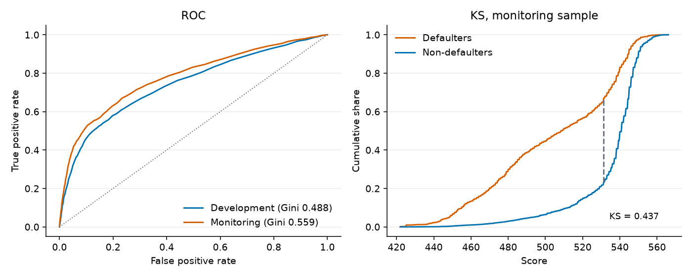
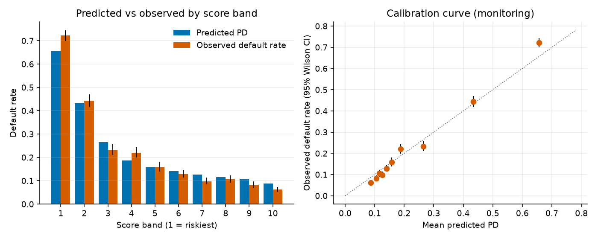

# Credit model audit report

_Generated by `model-audit`. Subject: a reference WoE scorecard built in this repository on a public dataset, audited against a simulated monitoring sample. This is a demonstration, not an assessment of any production model._

## 1. Scope and set-up

- Development sample: 15,000 accounts, observed default rate 22.51%, mean predicted PD 22.51%.
- Monitoring sample: 15,000 rows (after injected duplicates), observed default rate 21.73%, mean predicted PD 22.04%.
- Score scale: 600 points at 50:1 good:bad odds, PDO 20; random seed 42.
- Scorecard: optbinning binning, characteristics LIMIT_BAL, AGE, PAY_0, PAY_2, PAY_3, PAY_4, PAY_5, PAY_6, PAY_RATIO, UTIL_AVG, PAY_AMT_LIM, BILL_TREND; dropped for a wrong-sign coefficient: PAY6_RATIO; regularisation tuned by 5-fold CV: C = 0.316, L1 share 0.
- Status rule: Pass / Watch / Fail against the thresholds shown per check; the thresholds are conventions and must be aligned with the institution's policy.

## 2. Summary

**3 Fail, 2 Watch, 22 Pass** out of 27 checks.

Overall rating: Red (worst area; see rule in section 5).

| Area | Rating | Fail | Watch | Pass |
|---|---|---|---|---|
| Stability | Green | 0 | 0 | 13 |
| Discrimination | Green | 0 | 0 | 2 |
| Calibration | Red | 3 | 0 | 2 |
| Rating structure | Green | 0 | 0 | 2 |
| Data quality | Green | 0 | 0 | 3 |
| Benchmark | Amber | 0 | 2 | 0 |

| ID | Check | Metric | Value | Threshold | Status |
|---|---|---|---|---|---|
| DQ-01 | Missing values | max missing share (monitoring) | 0 | Watch >= 1%, Fail >= 5% per column | Pass |
| DQ-02 | Out-of-range values | max out-of-range share (monitoring) | 0 | Watch > 0.0%, Fail > 0.1% per column | Pass |
| DQ-03 | Duplicate IDs | duplicate share of IDs (monitoring) | 0 | Watch > 0.0%, Fail > 0.1% | Pass |
| ST-01 | Score PSI | PSI of final score (10 development deciles) | 0.005491 | Watch >= 0.1, Fail >= 0.25 | Pass |
| ST-02:LIMIT_BAL | CSI LIMIT_BAL | CSI of LIMIT_BAL on scorecard bins | 0.001694 | Watch >= 0.1, Fail >= 0.25 | Pass |
| ST-02:AGE | CSI AGE | CSI of AGE on scorecard bins | 0.0001006 | Watch >= 0.1, Fail >= 0.25 | Pass |
| ST-02:PAY_0 | CSI PAY_0 | CSI of PAY_0 on scorecard bins | 0.01287 | Watch >= 0.1, Fail >= 0.25 | Pass |
| ST-02:PAY_2 | CSI PAY_2 | CSI of PAY_2 on scorecard bins | 6.947e-06 | Watch >= 0.1, Fail >= 0.25 | Pass |
| ST-02:PAY_3 | CSI PAY_3 | CSI of PAY_3 on scorecard bins | 0.0001858 | Watch >= 0.1, Fail >= 0.25 | Pass |
| ST-02:PAY_4 | CSI PAY_4 | CSI of PAY_4 on scorecard bins | 0.005814 | Watch >= 0.1, Fail >= 0.25 | Pass |
| ST-02:PAY_5 | CSI PAY_5 | CSI of PAY_5 on scorecard bins | 0.002007 | Watch >= 0.1, Fail >= 0.25 | Pass |
| ST-02:PAY_6 | CSI PAY_6 | CSI of PAY_6 on scorecard bins | 0.00393 | Watch >= 0.1, Fail >= 0.25 | Pass |
| ST-02:PAY_RATIO | CSI PAY_RATIO | CSI of PAY_RATIO on scorecard bins | 0.0009472 | Watch >= 0.1, Fail >= 0.25 | Pass |
| ST-02:UTIL_AVG | CSI UTIL_AVG | CSI of UTIL_AVG on scorecard bins | 0.008062 | Watch >= 0.1, Fail >= 0.25 | Pass |
| ST-02:PAY_AMT_LIM | CSI PAY_AMT_LIM | CSI of PAY_AMT_LIM on scorecard bins | 0.00133 | Watch >= 0.1, Fail >= 0.25 | Pass |
| ST-02:BILL_TREND | CSI BILL_TREND | CSI of BILL_TREND on scorecard bins | 0.0011 | Watch >= 0.1, Fail >= 0.25 | Pass |
| DI-01 | Gini drift | Gini drop, development minus monitoring | -0.07154 | Watch >= 0.05, Fail >= 0.1 (absolute points) | Pass |
| DI-02 | KS drift | KS drop, development minus monitoring | -0.05568 | Watch >= 0.03, Fail >= 0.07 (absolute points) | Pass |
| CA-01 | Hosmer-Lemeshow | HL p-value, monitoring (10 groups) | 2.175e-12 | Watch <= 0.05, Fail <= 0.01 | Fail |
| CA-02 | Binomial test per grade | grades failing the one-sided test (p <= 0.01) | 2 | Pass: no grade p < 0.05; Fail: >= 2 grades p <= 0.01; otherwise Watch | Fail |
| CA-05 | Jeffreys test per grade | grades failing the Jeffreys test (p <= 0.01) | 2 | Pass: no grade p < 0.05; Fail: >= 2 grades p <= 0.01; otherwise Watch | Fail |
| CA-03 | Brier score | relative Brier increase vs development | -0.08765 | Watch >= 5%, Fail >= 15% | Pass |
| CA-04 | Calibration in the large | |observed / predicted default rate - 1| | 0.01404 | Watch >= 10%, Fail >= 25% | Pass |
| RG-01 | Rating-grade concentration | HHI of monitoring grade distribution | 0.1304 | Watch >= 0.15, Fail >= 0.25 (minimum possible 0.125) | Pass |
| RG-02 | Monotonicity of default rates | grade-pair inversions, monitoring | 0 | Watch >= 1, Fail >= 2 inversions | Pass |
| BM-01 | Challenger gap, monitoring | Gini(challenger) - Gini(champion) on monitoring data | 0.04834 | Watch >= 0.03, Fail >= 0.06 (Gini points, challenger minus champion) | Watch |
| BM-02 | Challenger gap, development CV | mean fold Gini gap, 5-fold CV on development data | 0.0543 | Watch >= 0.03, Fail >= 0.06 (Gini points, challenger minus champion) | Watch |

## 3. Findings

Raised for every check that is not Pass. Risk rating: Fail = High, Watch = Medium.

| # | Ref | Observation | Risk | Recommendation |
|---|---|---|---|---|
| 1 | CA-01 Hosmer-Lemeshow | HL chi-square 76.7 on 10 df, p = 2.18e-12 (development in-sample p = 0.0164). | High | Read together with the band table: if the deviation is directional and material, recalibrate the score-to-PD mapping; document the choice. |
| 2 | CA-02 Binomial test per grade | Observed default rate above grade PD in grade(s): 6 (22.9% vs 20.5%, n=1929, p=0.00564); 8 (72.2% vs 66.2%, n=1523, p=2.27e-07). | High | Recalibrate grade PDs or add a margin of conservatism; escalate where the under-prediction affects provisioning or pricing. |
| 3 | CA-05 Jeffreys test per grade | Grade PD likely too low in: 6 (p=0.00522, n=1929); 8 (p=1.96e-07, n=1523). | High | Use with CA-02. Where the two tests disagree, the grade is small enough that the conclusion should rest on the effect size, not the p-value. |
| 4 | BM-01 Challenger gap, monitoring | Gini 0.608 (challenger) vs 0.559 (champion), gap 0.048 (paired bootstrap 95% CI 0.037 to 0.061). Rank correlation of the two scores 0.79. | Medium | Review variables the challenger uses and the scorecard omits (feature importance, interactions) and decide whether to redevelop, add characteristics or accept the gap. |
| 5 | BM-02 Challenger gap, development CV | Gini 0.533 +/- 0.022 (challenger) vs 0.479 +/- 0.020 (champion), mean gap 0.054 +/- 0.013 over 5 folds (mean +/- sd; challenger won 5 of 5). | Medium | As BM-01. A gap that is stable across folds is structural; one driven by one fold is noise. |

### Tests without exception

- DQ-01 Missing values: No column exceeds the missing-value tolerance.
- DQ-02 Out-of-range values: No values outside the configured ranges.
- DQ-03 Duplicate IDs: No duplicate IDs.
- ST-01 Score PSI: Score PSI is 0.005; mean score moved from 527.7 to 528.5.
- ST-02:LIMIT_BAL CSI LIMIT_BAL: CSI 0.002; average score effect +0.1 points; largest move in bin (45000, 75000] (16.9% to 15.9%).
- ST-02:AGE CSI AGE: CSI 0.000; average score effect +0.0 points; largest move in bin (48.5, inf] (10.6% to 10.3%).
- ST-02:PAY_0 CSI PAY_0: CSI 0.013; average score effect +0.5 points; largest move in bin (-inf, -1.5] (7.6% to 10.7%).
- ST-02:PAY_2 CSI PAY_2: CSI 0.000; average score effect -0.0 points; largest move in bin (-inf, 1.5] (85.3% to 85.3%).
- ST-02:PAY_3 CSI PAY_3: CSI 0.000; average score effect +0.0 points; largest move in bin (-inf, 1.5] (85.7% to 86.2%).
- ST-02:PAY_4 CSI PAY_4: CSI 0.006; average score effect -0.1 points; largest move in bin (0.5, inf] (10.5% to 12.9%).
- ST-02:PAY_5 CSI PAY_5: CSI 0.002; average score effect +0.1 points; largest move in bin (-0.5, 1] (55.4% to 57.5%).
- ST-02:PAY_6 CSI PAY_6: CSI 0.004; average score effect +0.1 points; largest move in bin (-inf, 1] (88.8% to 90.7%).
- ST-02:PAY_RATIO CSI PAY_RATIO: CSI 0.001; average score effect -0.0 points; largest move in bin (0.000536351, 0.387266] (58.6% to 60.1%).
- ST-02:UTIL_AVG CSI UTIL_AVG: CSI 0.008; average score effect -0.0 points; largest move in bin (0.830778, 0.927414] (6.0% to 8.2%).
- ST-02:PAY_AMT_LIM CSI PAY_AMT_LIM: CSI 0.001; average score effect +0.2 points; largest move in bin (0.0603401, inf] (15.8% to 16.6%).
- ST-02:BILL_TREND CSI BILL_TREND: CSI 0.001; average score effect -0.1 points; largest move in bin (-inf, -0.0306219] (24.0% to 25.2%).
- DI-01 Gini drift: Gini 0.488 (95% CI 0.465-0.508) in development vs 0.559 (95% CI 0.541-0.578) in monitoring, a drop of -0.072 (95% CI -0.101 to -0.045).
- DI-02 KS drift: KS 0.381 (95% CI 0.365-0.399) in development vs 0.437 (95% CI 0.419-0.453) in monitoring, a drop of -0.056 (95% CI -0.080 to -0.032).
- CA-03 Brier score: Brier 0.1432 (development) vs 0.1306 (monitoring), -8.8%; the base-rate benchmark is 0.1701.
- CA-04 Calibration in the large: Predicted default rate 22.04% vs observed 21.73% (ratio 0.99; development ratio 1.00).
- RG-01 Rating-grade concentration: HHI 0.130 vs 0.131 in development (floor 0.125 for 8 grades); largest grade is 4 with 18.3% of accounts.
- RG-02 Monotonicity of default rates: Default rates are monotone across all 8 grades (development inversions: 0).

## 4. Supporting evidence

### Stability

| feature | csi | points_shift | status |
|---|---|---|---|
| LIMIT_BAL | 0.002 | 0.135 | Pass |
| AGE | 0.000 | 0.009 | Pass |
| PAY_0 | 0.013 | 0.513 | Pass |
| PAY_2 | 0.000 | -0.001 | Pass |
| PAY_3 | 0.000 | 0.047 | Pass |
| PAY_4 | 0.006 | -0.121 | Pass |
| PAY_5 | 0.002 | 0.079 | Pass |
| PAY_6 | 0.004 | 0.076 | Pass |
| PAY_RATIO | 0.001 | -0.008 | Pass |
| UTIL_AVG | 0.008 | -0.046 | Pass |
| PAY_AMT_LIM | 0.001 | 0.195 | Pass |
| BILL_TREND | 0.001 | -0.054 | Pass |

### Discrimination

| metric | sample | value | 95% CI |
|---|---|---|---|
| AUC | dev | 0.744 | 0.732 to 0.754 |
| AUC | mon | 0.780 | 0.769 to 0.789 |
| Gini | dev | 0.488 | 0.465 to 0.508 |
| Gini | mon | 0.559 | 0.541 to 0.578 |
| KS | dev | 0.381 | 0.365 to 0.399 |
| KS | mon | 0.437 | 0.419 to 0.453 |

### Calibration by score band (monitoring)

| band | n | mean_pd | observed_dr | ci_low | ci_high |
|---|---|---|---|---|---|
| 1 | 1523 | 65.7% | 72.2% | 69.9% | 74.4% |
| 2 | 1319 | 43.4% | 44.4% | 41.7% | 47.0% |
| 3 | 1217 | 26.5% | 23.3% | 21.0% | 25.8% |
| 4 | 1383 | 18.7% | 22.1% | 19.9% | 24.3% |
| 5 | 1210 | 15.7% | 15.8% | 13.8% | 17.9% |
| 6 | 1870 | 14.0% | 12.9% | 11.4% | 14.5% |
| 7 | 1566 | 12.6% | 9.8% | 8.4% | 11.3% |
| 8 | 1470 | 11.5% | 10.5% | 9.1% | 12.2% |
| 9 | 1612 | 10.6% | 8.2% | 6.9% | 9.6% |
| 10 | 1830 | 8.7% | 6.2% | 5.2% | 7.4% |

### Binomial test by rating grade (monitoring)

| grade | n | defaults | grade_pd | observed_dr | p_value | status | p_holm |
|---|---|---|---|---|---|---|---|
| 1 | 1499 | 89 | 8.4% | 5.9% | 1 | Pass | 1 |
| 2 | 1943 | 156 | 10.5% | 8.0% | 1 | Pass | 1 |
| 3 | 1470 | 155 | 11.5% | 10.5% | 0.89 | Pass | 1 |
| 4 | 2743 | 296 | 13.1% | 10.8% | 1 | Pass | 1 |
| 5 | 1903 | 289 | 15.3% | 15.2% | 0.55 | Pass | 1 |
| 6 | 1929 | 441 | 20.5% | 22.9% | 0.0056 | Fail | 0.04 |
| 7 | 1990 | 733 | 38.3% | 36.8% | 0.92 | Pass | 1 |
| 8 | 1523 | 1100 | 66.2% | 72.2% | 2.3e-07 | Fail | 1.8e-06 |

### Jeffreys test by rating grade (monitoring)

| grade | n | defaults | grade_pd | p_value | status | p_holm |
|---|---|---|---|---|---|---|
| 1 | 1499 | 89 | 8.4% | 1 | Pass | 1 |
| 2 | 1943 | 156 | 10.5% | 1 | Pass | 1 |
| 3 | 1470 | 155 | 11.5% | 0.88 | Pass | 1 |
| 4 | 2743 | 296 | 13.1% | 1 | Pass | 1 |
| 5 | 1903 | 289 | 15.3% | 0.54 | Pass | 1 |
| 6 | 1929 | 441 | 20.5% | 0.0052 | Fail | 0.037 |
| 7 | 1990 | 733 | 38.3% | 0.92 | Pass | 1 |
| 8 | 1523 | 1100 | 66.2% | 2e-07 | Fail | 1.6e-06 |

### Rating grades

| grade | dev_share | mon_share | dev_dr | mon_dr |
|---|---|---|---|---|
| 1 | 9.3% | 10.0% | 8.0% | 5.9% |
| 2 | 12.0% | 13.0% | 10.1% | 8.0% |
| 3 | 9.6% | 9.8% | 10.8% | 10.5% |
| 4 | 17.8% | 18.3% | 13.2% | 10.8% |
| 5 | 12.8% | 12.7% | 16.6% | 15.2% |
| 6 | 13.8% | 12.9% | 20.9% | 22.9% |
| 7 | 14.9% | 13.3% | 38.1% | 36.8% |
| 8 | 9.9% | 10.2% | 65.7% | 72.2% |

### Champion vs challenger

| model | cv_gini | mon_gini | mon_ks | mon_brier | mean_pd |
|---|---|---|---|---|---|
| Champion scorecard | 0.479 +/- 0.020 | 0.559 | 0.437 | 0.131 | 22.0% |
| Challenger LightGBM | 0.533 +/- 0.022 | 0.608 | 0.455 | 0.127 | 21.6% |

| fold | champion_gini | challenger_gini | champion_auc | challenger_auc | champion_ks | challenger_ks |
|---|---|---|---|---|---|---|
| 1 | 0.504 | 0.555 | 0.752 | 0.778 | 0.394 | 0.421 |
| 2 | 0.470 | 0.534 | 0.735 | 0.767 | 0.384 | 0.410 |
| 3 | 0.468 | 0.502 | 0.734 | 0.751 | 0.392 | 0.398 |
| 4 | 0.458 | 0.522 | 0.729 | 0.761 | 0.361 | 0.405 |
| 5 | 0.495 | 0.554 | 0.748 | 0.777 | 0.392 | 0.427 |

Challenger hyper-parameters (Optuna, TPE, 5-fold CV log loss):

| parameter | value |
|---|---|
| n_estimators | 309.0000 |
| learning_rate | 0.0170 |
| num_leaves | 16.0000 |
| min_child_samples | 62.0000 |
| subsample | 0.8517 |
| colsample_bytree | 0.6212 |
| reg_lambda | 4.7416 |
| features | 26.0000 |

### Data quality

| column | dev_missing | mon_missing |
|---|---|---|
| LIMIT_BAL | 0.0% | 0.0% |
| AGE | 0.0% | 0.0% |
| PAY_0 | 0.0% | 0.0% |
| PAY_2 | 0.0% | 0.0% |
| PAY_3 | 0.0% | 0.0% |
| PAY_4 | 0.0% | 0.0% |
| PAY_5 | 0.0% | 0.0% |
| PAY_6 | 0.0% | 0.0% |
| PAY_RATIO | 0.0% | 0.0% |
| UTIL_AVG | 0.0% | 0.0% |
| PAY6_RATIO | 0.0% | 0.0% |
| PAY_AMT_LIM | 0.0% | 0.0% |
| BILL_TREND | 0.0% | 0.0% |
| BILL_AMT1 | 0.0% | 0.0% |
| PAY_AMT1 | 0.0% | 0.0% |

| column | allowed | violations | share |
|---|---|---|---|
| LIMIT_BAL | [10000, 1000000] | 0 | 0.0% |
| AGE | [18, 100] | 0 | 0.0% |
| PAY_0 | [-2, 9] | 0 | 0.0% |
| PAY_2 | [-2, 9] | 0 | 0.0% |
| PAY_3 | [-2, 9] | 0 | 0.0% |
| PAY_AMT1 | [0, 2000000] | 0 | 0.0% |

## 5. Method notes

- Every metric is re-computed from record-level data with the library code in `src/model_audit`; nothing is taken from model documentation.
- PD: cubic logistic recalibration of default on the standardised score, fitted on the development sample, frozen and applied to monitoring (calibrate_pd = false falls back to the points-scale PD, logit(PD) = (offset - score) / factor).
- Bootstrap CIs: percentile method, resampling accounts with replacement.
- Hosmer-Lemeshow on monitoring uses groups degrees of freedom (frozen model).
- Traffic light: an area is Red if any of its checks Fails, Amber if any is Watch, otherwise Green. The overall rating is the worst area.
- Large samples make formal tests reject small deviations: read p-values with the effect sizes.
