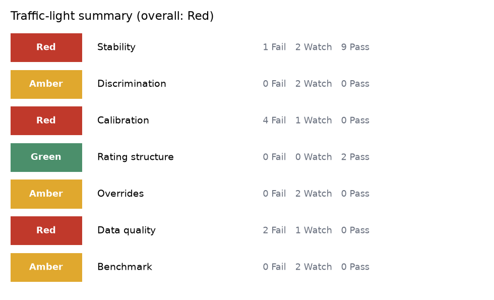
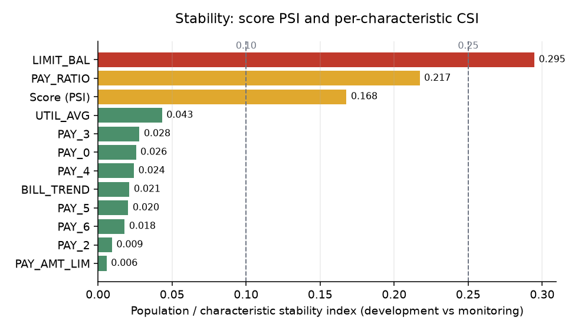
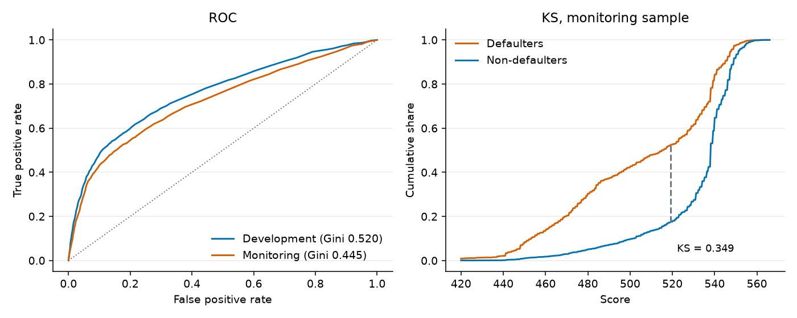
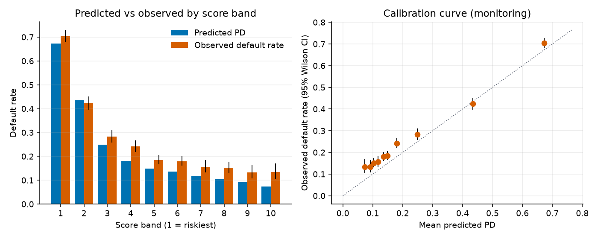

# Credit model audit report

_Generated by `model-audit`. Subject: a reference WoE scorecard built in this repository on a public dataset, audited against a simulated monitoring sample. This is a demonstration, not an assessment of any production model._

## 1. Scope and set-up

- Development sample: 15,000 accounts, observed default rate 21.66%, mean predicted PD 21.66%.
- Monitoring sample: 10,505 rows (after injected duplicates), observed default rate 28.78%, mean predicted PD 25.08%.
- Score scale: 600 points at 50:1 good:bad odds, PDO 20; random seed 42.
- Scorecard: optbinning binning, characteristics LIMIT_BAL, PAY_0, PAY_2, PAY_3, PAY_4, PAY_5, PAY_6, PAY_RATIO, UTIL_AVG, PAY_AMT_LIM, BILL_TREND; dropped for a wrong-sign coefficient: PAY6_RATIO, AGE; regularisation tuned by 5-fold CV: C = 0.1, L1 share 0.
- Status rule: Pass / Watch / Fail against the thresholds shown per check; the thresholds are conventions and must be aligned with the institution's policy.

### Simulated drift (ground truth injected into the monitoring sample)

- Population mix: 4515 accounts with LIMIT_BAL >= 200,000 removed (drop prob 80%).
- Repayment drift: PAY_AMT1 multiplied by 0.6.
- Outcome deterioration: 327 non-defaulting, currently-paying accounts (5% of them) relabelled as defaults.
- Missing values: PAY_AMT1 blanked for 305 rows.
- Out-of-range values: AGE set to sentinel 999 for 40 rows.
- Duplicate IDs: 20 rows appended twice (ID repeated).

## 2. Summary

**7 Fail, 10 Watch, 11 Pass** out of 28 checks.

Overall rating: Red (worst area; see rule in section 5).

| Area | Rating | Fail | Watch | Pass |
|---|---|---|---|---|
| Stability | Red | 1 | 2 | 9 |
| Discrimination | Amber | 0 | 2 | 0 |
| Calibration | Red | 4 | 1 | 0 |
| Rating structure | Green | 0 | 0 | 2 |
| Overrides | Amber | 0 | 2 | 0 |
| Data quality | Red | 2 | 1 | 0 |
| Benchmark | Amber | 0 | 2 | 0 |

| ID | Check | Metric | Value | Threshold | Status |
|---|---|---|---|---|---|
| DQ-01 | Missing values | max missing share (monitoring) | 0.02913 | Watch >= 1%, Fail >= 5% per column | Watch |
| DQ-02 | Out-of-range values | max out-of-range share (monitoring) | 0.003808 | Watch > 0.0%, Fail > 0.1% per column | Fail |
| DQ-03 | Duplicate IDs | duplicate share of IDs (monitoring) | 0.001904 | Watch > 0.0%, Fail > 0.1% | Fail |
| ST-01 | Score PSI | PSI of final score (10 development deciles) | 0.1678 | Watch >= 0.1, Fail >= 0.25 | Watch |
| ST-02:LIMIT_BAL | CSI LIMIT_BAL | CSI of LIMIT_BAL on scorecard bins | 0.2947 | Watch >= 0.1, Fail >= 0.25 | Fail |
| ST-02:PAY_0 | CSI PAY_0 | CSI of PAY_0 on scorecard bins | 0.02561 | Watch >= 0.1, Fail >= 0.25 | Pass |
| ST-02:PAY_2 | CSI PAY_2 | CSI of PAY_2 on scorecard bins | 0.009404 | Watch >= 0.1, Fail >= 0.25 | Pass |
| ST-02:PAY_3 | CSI PAY_3 | CSI of PAY_3 on scorecard bins | 0.02794 | Watch >= 0.1, Fail >= 0.25 | Pass |
| ST-02:PAY_4 | CSI PAY_4 | CSI of PAY_4 on scorecard bins | 0.02422 | Watch >= 0.1, Fail >= 0.25 | Pass |
| ST-02:PAY_5 | CSI PAY_5 | CSI of PAY_5 on scorecard bins | 0.02038 | Watch >= 0.1, Fail >= 0.25 | Pass |
| ST-02:PAY_6 | CSI PAY_6 | CSI of PAY_6 on scorecard bins | 0.01795 | Watch >= 0.1, Fail >= 0.25 | Pass |
| ST-02:PAY_RATIO | CSI PAY_RATIO | CSI of PAY_RATIO on scorecard bins | 0.2172 | Watch >= 0.1, Fail >= 0.25 | Watch |
| ST-02:UTIL_AVG | CSI UTIL_AVG | CSI of UTIL_AVG on scorecard bins | 0.04321 | Watch >= 0.1, Fail >= 0.25 | Pass |
| ST-02:PAY_AMT_LIM | CSI PAY_AMT_LIM | CSI of PAY_AMT_LIM on scorecard bins | 0.005739 | Watch >= 0.1, Fail >= 0.25 | Pass |
| ST-02:BILL_TREND | CSI BILL_TREND | CSI of BILL_TREND on scorecard bins | 0.02117 | Watch >= 0.1, Fail >= 0.25 | Pass |
| DI-01 | Gini drift | Gini drop, development minus monitoring | 0.07524 | Watch >= 0.05, Fail >= 0.1 (absolute points) | Watch |
| DI-02 | KS drift | KS drop, development minus monitoring | 0.05255 | Watch >= 0.03, Fail >= 0.07 (absolute points) | Watch |
| CA-01 | Hosmer-Lemeshow | HL p-value, monitoring (10 groups) | 7.018e-29 | Watch <= 0.05, Fail <= 0.01 | Fail |
| CA-02 | Binomial test per grade | grades failing the one-sided test (p <= 0.01) | 5 | Pass: no grade p < 0.05; Fail: >= 2 grades p <= 0.01; otherwise Watch | Fail |
| CA-05 | Jeffreys test per grade | grades failing the Jeffreys test (p <= 0.01) | 6 | Pass: no grade p < 0.05; Fail: >= 2 grades p <= 0.01; otherwise Watch | Fail |
| CA-03 | Brier score | relative Brier increase vs development | 0.2668 | Watch >= 5%, Fail >= 15% | Fail |
| CA-04 | Calibration in the large | |observed / predicted default rate - 1| | 0.1474 | Watch >= 10%, Fail >= 25% | Watch |
| RG-01 | Rating-grade concentration | HHI of monitoring grade distribution | 0.1474 | Watch >= 0.15, Fail >= 0.25 (minimum possible 0.125) | Pass |
| RG-02 | Monotonicity of default rates | grade-pair inversions, monitoring | 0 | Watch >= 1, Fail >= 2 inversions | Pass |
| OV-01 | Override rate | overrides / decisions, monitoring | 0.07025 | Watch >= 5%, Fail >= 10% | Watch |
| OV-02 | Override performance | low-side override DR minus same-zone non-override DR | -0.02508 | Pass: override DR significantly lower (Fisher p < 0.05); Fail: significantly higher; else Watch | Watch |
| BM-01 | Challenger gap, monitoring | Gini(challenger) - Gini(champion) on monitoring data | 0.03956 | Watch >= 0.03, Fail >= 0.06 (Gini points, challenger minus champion) | Watch |
| BM-02 | Challenger gap, development CV | mean fold Gini gap, 5-fold CV on development data | 0.04914 | Watch >= 0.03, Fail >= 0.06 (Gini points, challenger minus champion) | Watch |

## 3. Findings

Raised for every check that is not Pass. Risk rating: Fail = High, Watch = Medium.

| # | Ref | Observation | Risk | Recommendation |
|---|---|---|---|---|
| 1 | DQ-02 Out-of-range values | Out-of-range values: AGE 40 rows (0.38%, allowed [18, 100]). | High | Add range validation at ingestion, quarantine violating records and confirm how the scorecard bins them (they currently fall in the extreme bin). |
| 2 | DQ-03 Duplicate IDs | 20 duplicate ID values (0.19% of 10,505 monitoring rows). | High | Deduplicate on the account key, find the process that creates repeats and reconcile record counts to the source system. |
| 3 | ST-02:LIMIT_BAL CSI LIMIT_BAL | CSI 0.295; average score effect -2.9 points; largest move in bin (245000, 365000] (15.1% to 4.3%). | High | Confirm whether the LIMIT_BAL shift is genuine population change or an upstream data/definition change; reassess bin cut-offs and points if it persists. |
| 4 | CA-01 Hosmer-Lemeshow | HL chi-square 158.4 on 10 df, p = 7.02e-29 (development in-sample p = 0.621). | High | Read together with the band table: if the deviation is directional and material, recalibrate the score-to-PD mapping; document the choice. |
| 5 | CA-02 Binomial test per grade | Observed default rate above grade PD in grade(s): 1 (10.6% vs 6.9%, n=282, p=0.0137); 2 (14.5% vs 8.9%, n=683, p=1.3e-06); 3 (15.2% vs 10.3%, n=1021, p=9.64e-07); 4 (16.6% vs 12.5%, n=1653, p=7.6e-07); 5 (18.6% vs 14.6%, n=1937, p=8.28e-07); 6 (25.7% vs 19.6%, n=1842, p=1.14e-10); 8 (70.5% vs 67.6%, n=1402, p=0.0104). | High | Recalibrate grade PDs or add a margin of conservatism; escalate where the under-prediction affects provisioning or pricing. |
| 6 | CA-05 Jeffreys test per grade | Grade PD likely too low in: 1 (p=0.0105, n=282); 2 (p=9.79e-07, n=683); 3 (p=7.67e-07, n=1021); 4 (p=6.4e-07, n=1653); 5 (p=7.12e-07, n=1937); 6 (p=9.55e-11, n=1842); 8 (p=0.00964, n=1402). | High | Use with CA-02. Where the two tests disagree, the grade is small enough that the conclusion should rest on the effect size, not the p-value. |
| 7 | CA-03 Brier score | Brier 0.1359 (development) vs 0.1722 (monitoring), +26.7%; the base-rate benchmark is 0.2050. | High | Decompose into calibration and discrimination loss using the band and Gini results. |
| 8 | DQ-01 Missing values | Missing values above tolerance in: PAY_RATIO (2.9% vs 0.0% in development), PAY_AMT1 (2.9% vs 0.0% in development). | Medium | Trace the source of the gaps, confirm the scorecard's missing-value treatment is intended and add a completeness control on the input feed. |
| 9 | ST-01 Score PSI | Score PSI is 0.168; mean score moved from 529.6 to 523.9. | Medium | Investigate which characteristics drive the shift (see CSI), decide whether the change is a population move or a data issue, and document the decision to keep, recalibrate or redevelop. |
| 10 | ST-02:PAY_RATIO CSI PAY_RATIO | CSI 0.217; average score effect -0.1 points; largest move in bin (0.251784, inf] (32.1% to 21.5%). | Medium | Confirm whether the PAY_RATIO shift is genuine population change or an upstream data/definition change; reassess bin cut-offs and points if it persists. |
| 11 | DI-01 Gini drift | Gini 0.520 (95% CI 0.502-0.540) in development vs 0.445 (95% CI 0.424-0.465) in monitoring, a drop of 0.075 (95% CI 0.046 to 0.102). | Medium | Check whether the loss comes from specific characteristics or segments, and assess whether recalibration is enough or redevelopment is required. |
| 12 | DI-02 KS drift | KS 0.402 (95% CI 0.386-0.423) in development vs 0.349 (95% CI 0.332-0.369) in monitoring, a drop of 0.053 (95% CI 0.027 to 0.084). | Medium | Check whether the loss comes from specific characteristics or segments, and assess whether recalibration is enough or redevelopment is required. |
| 13 | CA-04 Calibration in the large | Predicted default rate 25.08% vs observed 28.78% (ratio 1.15; development ratio 1.00). | Medium | If observed exceeds predicted, quantify the provisioning/pricing impact and apply a scalar recalibration or an overlay until the model is redeveloped. |
| 14 | OV-01 Override rate | 738 overrides on 10,505 decisions (7.0%): 585 low-side (approved below cut-off 523, 19.0% of the decline zone) and 153 high-side. | Medium | Obtain override reason codes and approver authority, and report rates by approver and branch against the policy limit. |
| 15 | OV-02 Override performance | Low-side overrides: default rate 50.8% (n=585, mean predicted PD 51.9%) vs 53.3% for non-overridden accounts in the same zone (n=2,502); one-sided p = 0.147 (lower) / 0.873 (higher): no evidence that overrides add value over the score. | Medium | Back-test override rationales, require documented evidence for low-side overrides and monitor their performance separately. |
| 16 | BM-01 Challenger gap, monitoring | Gini 0.485 (challenger) vs 0.445 (champion), gap 0.040 (paired bootstrap 95% CI 0.027 to 0.053). Rank correlation of the two scores 0.83. | Medium | Review variables the challenger uses and the scorecard omits (feature importance, interactions) and decide whether to redevelop, add characteristics or accept the gap. |
| 17 | BM-02 Challenger gap, development CV | Gini 0.565 +/- 0.008 (challenger) vs 0.516 +/- 0.008 (champion), mean gap 0.049 +/- 0.006 over 5 folds (mean +/- sd; challenger won 5 of 5). | Medium | As BM-01. A gap that is stable across folds is structural; one driven by one fold is noise. |

### Tests without exception

- ST-02:PAY_0 CSI PAY_0: CSI 0.026; average score effect -1.6 points; largest move in bin (-inf, -1.5] (9.4% to 5.6%).
- ST-02:PAY_2 CSI PAY_2: CSI 0.009; average score effect -0.2 points; largest move in bin (1.5, inf] (14.6% to 18.2%).
- ST-02:PAY_3 CSI PAY_3: CSI 0.028; average score effect -0.3 points; largest move in bin (-inf, -0.5] (33.5% to 26.1%).
- ST-02:PAY_4 CSI PAY_4: CSI 0.024; average score effect -0.2 points; largest move in bin (-inf, -0.5] (33.6% to 26.8%).
- ST-02:PAY_5 CSI PAY_5: CSI 0.020; average score effect -0.2 points; largest move in bin (-inf, -0.5] (33.8% to 27.7%).
- ST-02:PAY_6 CSI PAY_6: CSI 0.018; average score effect -0.1 points; largest move in bin (-inf, -0.5] (35.7% to 29.7%).
- ST-02:UTIL_AVG CSI UTIL_AVG: CSI 0.043; average score effect -0.1 points; largest move in bin (-inf, 0.307364] (51.7% to 41.4%).
- ST-02:PAY_AMT_LIM CSI PAY_AMT_LIM: CSI 0.006; average score effect +0.1 points; largest move in bin (0.00348886, 0.067575] (74.0% to 76.4%).
- ST-02:BILL_TREND CSI BILL_TREND: CSI 0.021; average score effect -0.1 points; largest move in bin (-inf, -0.0422182] (21.3% to 25.1%).
- RG-01 Rating-grade concentration: HHI 0.147 vs 0.129 in development (floor 0.125 for 8 grades); largest grade is 5 with 18.4% of accounts.
- RG-02 Monotonicity of default rates: Default rates are monotone across all 8 grades (development inversions: 0).

## 4. Supporting evidence

### Stability

| feature | csi | points_shift | status |
|---|---|---|---|
| LIMIT_BAL | 0.295 | -2.868 | Fail |
| PAY_0 | 0.026 | -1.642 | Pass |
| PAY_2 | 0.009 | -0.179 | Pass |
| PAY_3 | 0.028 | -0.250 | Pass |
| PAY_4 | 0.024 | -0.211 | Pass |
| PAY_5 | 0.020 | -0.230 | Pass |
| PAY_6 | 0.018 | -0.109 | Pass |
| PAY_RATIO | 0.217 | -0.120 | Watch |
| UTIL_AVG | 0.043 | -0.083 | Pass |
| PAY_AMT_LIM | 0.006 | 0.104 | Pass |
| BILL_TREND | 0.021 | -0.080 | Pass |

### Discrimination

| metric | sample | value | 95% CI |
|---|---|---|---|
| AUC | dev | 0.760 | 0.750 to 0.770 |
| AUC | mon | 0.722 | 0.710 to 0.735 |
| Gini | dev | 0.520 | 0.502 to 0.540 |
| Gini | mon | 0.445 | 0.424 to 0.465 |
| KS | dev | 0.402 | 0.386 to 0.423 |
| KS | mon | 0.349 | 0.332 to 0.369 |

### Calibration by score band (monitoring)

| band | n | mean_pd | observed_dr | ci_low | ci_high |
|---|---|---|---|---|---|
| 1 | 1402 | 67.2% | 70.5% | 68.0% | 72.8% |
| 2 | 1199 | 43.4% | 42.4% | 39.6% | 45.2% |
| 3 | 1080 | 24.8% | 28.3% | 25.7% | 31.1% |
| 4 | 1248 | 18.0% | 24.2% | 21.9% | 26.7% |
| 5 | 1410 | 14.8% | 18.5% | 16.6% | 20.6% |
| 6 | 1412 | 13.6% | 18.0% | 16.1% | 20.1% |
| 7 | 768 | 11.8% | 15.6% | 13.2% | 18.4% |
| 8 | 1021 | 10.3% | 15.2% | 13.1% | 17.5% |
| 9 | 547 | 9.1% | 13.3% | 10.7% | 16.5% |
| 10 | 418 | 7.4% | 13.4% | 10.5% | 17.0% |

### Binomial test by rating grade (monitoring)

| grade | n | defaults | grade_pd | observed_dr | p_value | status | p_holm |
|---|---|---|---|---|---|---|---|
| 1 | 282 | 30 | 6.9% | 10.6% | 0.014 | Watch | 0.031 |
| 2 | 683 | 99 | 8.9% | 14.5% | 1.3e-06 | Fail | 5.3e-06 |
| 3 | 1021 | 155 | 10.3% | 15.2% | 9.6e-07 | Fail | 5.3e-06 |
| 4 | 1653 | 274 | 12.5% | 16.6% | 7.6e-07 | Fail | 5.3e-06 |
| 5 | 1937 | 361 | 14.6% | 18.6% | 8.3e-07 | Fail | 5.3e-06 |
| 6 | 1842 | 474 | 19.6% | 25.7% | 1.1e-10 | Fail | 9.1e-10 |
| 7 | 1685 | 642 | 39.0% | 38.1% | 0.77 | Pass | 0.77 |
| 8 | 1402 | 988 | 67.6% | 70.5% | 0.01 | Watch | 0.031 |

### Jeffreys test by rating grade (monitoring)

| grade | n | defaults | grade_pd | p_value | status | p_holm |
|---|---|---|---|---|---|---|
| 1 | 282 | 30 | 6.9% | 0.01 | Watch | 0.029 |
| 2 | 683 | 99 | 8.9% | 9.8e-07 | Fail | 4.5e-06 |
| 3 | 1021 | 155 | 10.3% | 7.7e-07 | Fail | 4.5e-06 |
| 4 | 1653 | 274 | 12.5% | 6.4e-07 | Fail | 4.5e-06 |
| 5 | 1937 | 361 | 14.6% | 7.1e-07 | Fail | 4.5e-06 |
| 6 | 1842 | 474 | 19.6% | 9.6e-11 | Fail | 7.6e-10 |
| 7 | 1685 | 642 | 39.0% | 0.76 | Pass | 0.76 |
| 8 | 1402 | 988 | 67.6% | 0.0096 | Fail | 0.029 |

### Rating grades

| grade | dev_share | mon_share | dev_dr | mon_dr |
|---|---|---|---|---|
| 1 | 8.4% | 2.7% | 6.4% | 10.6% |
| 2 | 13.8% | 6.5% | 8.8% | 14.5% |
| 3 | 11.9% | 9.7% | 10.8% | 15.2% |
| 4 | 14.3% | 15.7% | 12.1% | 16.6% |
| 5 | 13.4% | 18.4% | 14.8% | 18.6% |
| 6 | 14.3% | 17.5% | 20.9% | 25.7% |
| 7 | 14.4% | 16.0% | 38.6% | 38.1% |
| 8 | 9.6% | 13.3% | 66.7% | 70.5% |

### Overrides

| group | n | defaults | default_rate | mean_pd |
|---|---|---|---|---|
| Low-side override | 585 | 297 | 50.8% | 51.9% |
| Decline zone, no override | 2502 | 1333 | 53.3% | 51.7% |
| Approve zone, no override | 7265 | 1367 | 18.8% | 14.0% |
| High-side override | 153 | 26 | 17.0% | 14.8% |

### Champion vs challenger

| model | cv_gini | mon_gini | mon_ks | mon_brier | mean_pd |
|---|---|---|---|---|---|
| Champion scorecard | 0.516 +/- 0.008 | 0.445 | 0.349 | 0.172 | 25.1% |
| Challenger LightGBM | 0.565 +/- 0.008 | 0.485 | 0.373 | 0.169 | 25.5% |

| fold | champion_gini | challenger_gini | champion_auc | challenger_auc | champion_ks | challenger_ks |
|---|---|---|---|---|---|---|
| 1 | 0.510 | 0.562 | 0.755 | 0.781 | 0.409 | 0.419 |
| 2 | 0.526 | 0.569 | 0.763 | 0.785 | 0.405 | 0.432 |
| 3 | 0.522 | 0.576 | 0.761 | 0.788 | 0.410 | 0.442 |
| 4 | 0.507 | 0.562 | 0.753 | 0.781 | 0.392 | 0.424 |
| 5 | 0.515 | 0.557 | 0.758 | 0.779 | 0.419 | 0.440 |

Challenger hyper-parameters (Optuna, TPE, 5-fold CV log loss):

| parameter | value |
|---|---|
| n_estimators | 412.0000 |
| learning_rate | 0.0150 |
| num_leaves | 19.0000 |
| min_child_samples | 40.0000 |
| subsample | 0.9396 |
| colsample_bytree | 0.5582 |
| reg_lambda | 24.7704 |
| features | 26.0000 |

### Data quality

| column | dev_missing | mon_missing |
|---|---|---|
| LIMIT_BAL | 0.0% | 0.0% |
| AGE | 0.0% | 0.0% |
| PAY_0 | 0.0% | 0.0% |
| PAY_2 | 0.0% | 0.0% |
| PAY_3 | 0.0% | 0.0% |
| PAY_4 | 0.0% | 0.0% |
| PAY_5 | 0.0% | 0.0% |
| PAY_6 | 0.0% | 0.0% |
| PAY_RATIO | 0.0% | 2.9% |
| UTIL_AVG | 0.0% | 0.0% |
| PAY6_RATIO | 0.0% | 0.0% |
| PAY_AMT_LIM | 0.0% | 0.0% |
| BILL_TREND | 0.0% | 0.0% |
| BILL_AMT1 | 0.0% | 0.0% |
| PAY_AMT1 | 0.0% | 2.9% |

| column | allowed | violations | share |
|---|---|---|---|
| LIMIT_BAL | [10000, 1000000] | 0 | 0.0% |
| AGE | [18, 100] | 40 | 0.4% |
| PAY_0 | [-2, 9] | 0 | 0.0% |
| PAY_2 | [-2, 9] | 0 | 0.0% |
| PAY_3 | [-2, 9] | 0 | 0.0% |
| PAY_AMT1 | [0, 2000000] | 0 | 0.0% |

## 5. Method notes

- Every metric is re-computed from record-level data with the library code in `src/model_audit`; nothing is taken from model documentation.
- PD: cubic logistic recalibration of default on the standardised score, fitted on the development sample, frozen and applied to monitoring (calibrate_pd = false falls back to the points-scale PD, logit(PD) = (offset - score) / factor).
- Bootstrap CIs: percentile method, resampling accounts with replacement.
- Hosmer-Lemeshow on monitoring uses groups degrees of freedom (frozen model).
- Traffic light: an area is Red if any of its checks Fails, Amber if any is Watch, otherwise Green. The overall rating is the worst area.
- Large samples make formal tests reject small deviations: read p-values with the effect sizes.
